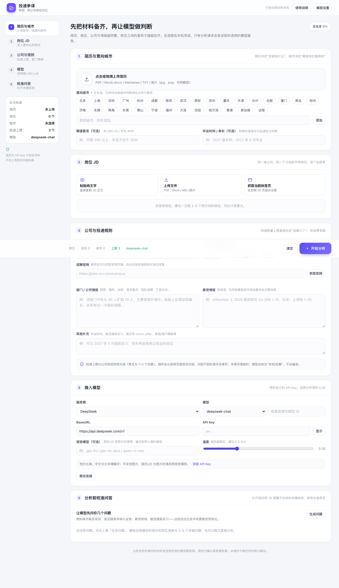
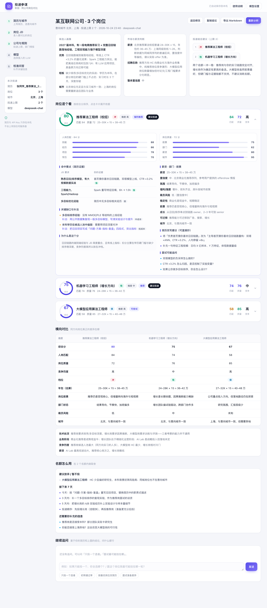

# 投递参谋 · 秋招岗位匹配对比（Chrome 扩展）

秋招时同一家公司同方向的岗位往往有 3–5 个，但能投的名额通常只有 1–3 个。这个插件用来回答一个问题：**这几个岗位，我的简历该投哪几个、按什么顺序投。**

它把简历、多个岗位 JD、意向城市、投递上限、部门/薪资情报一起交给**你自己选择的 LLM**，输出逐岗评分、证据对照、缺口补法、简历改写建议和投递组合（冲/稳/保）。



## 能做什么

| 能力 | 说明 |
| --- | --- |
| 简历解析 | PDF（带中文 CMap，中文简历不乱码）、Word `.docx`、Markdown、TXT、图片（jpg/png，交给视觉模型） |
| JD 录入 | 粘贴纯文字 / 上传 PDF、Word、MD、图片 / **一键抓取当前标签页正文**（在官网 JD 页点一下即可） |
| 意向城市 | 30 个常用城市多选 + 自定义；分析时用于判断岗位分布与薪资口径 |
| 投递上限 | 手动填写，或抓取招聘官网后**自动识别**「最多可投递 N 个岗位」并一键采用 |
| 公司与情报 | 部门氛围、福利、加班、裁员传闻、薪资截图内容——模型会区分「你提供的事实」与「它的推测」 |
| 模型接入 | DeepSeek / OpenAI / Kimi / 智谱 GLM / 通义千问 / 豆包 / Claude / Gemini / 本地 Ollama / 任意 OpenAI 兼容服务 |
| 校准问答 | 分析前让模型反问你 4–6 个真正影响决策的问题（城市能否妥协、薪资底线、是否接受非核心业务…） |
| 追问 | 分析后可就结果继续对话：只投一个选谁、面试最可能挂在哪、按最优岗位改简历 |
| 结果 | 综合分排序 + 匹配/质量双维拆解 + 命中证据 + 缺口补法 + 简历改写句 + 面试追问 + 投递组合 |
| 导出 | 一键导出 Markdown、复制纯文本结论 |



## 安装

1. 打开 `chrome://extensions/`
2. 右上角开启 **开发者模式**
3. 点 **加载已解压的扩展程序**，选择本目录 `job-match-ext`
4. 点工具栏的紫色图标打开工作台（会自动在新标签页打开）

> 也可以在地址栏直接访问 `chrome-extension://<扩展ID>/app.html`。

## ⚠️ 先看这条：国内网络与零成本方案

`api.openai.com`、`api.anthropic.com`、Google 的接口在国内网络**无法直连**：DNS 被污染到假 IP，TCP 根本建不起来，表现就是「点测试连接一直转圈，30 秒后报超时」。**这不是 Key 的问题，也不是余额的问题**——充钱也不会好。

另外，OpenAI API 与 ChatGPT Plus 是两套计费，订阅 Plus 并不包含 API 额度，账户没余额会返回 `429 insufficient_quota`。

想不花钱跑起来，按顺序试：

| 方案 | 成本 | 网络 | 怎么用 |
| --- | --- | --- | --- |
| 智谱 GLM-4-Flash | 免费 | 国内直连 | 选「智谱 GLM」，模型填 `glm-4-flash` |
| 通义 qwen-turbo | 有免费额度 | 国内直连 | 选「通义千问」，模型填 `qwen-turbo` |
| 豆包 / Kimi | 有免费额度 | 国内直连 | 注册即送，模型名见官网 |
| 本地 Ollama | 免费 | 不需要网络 | `ollama pull qwen2.5:7b`，简历不出本机 |
| OpenAI / Claude | 需预充值 | 需代理 | 两者缺一不可 |

实测（2026-10，家用宽带，`curl` 直连）：OpenAI 8 秒连接失败；智谱 / 通义 / Kimi / 豆包 / DeepSeek 都在 0.3 秒内返回。

## 配置模型（任选一个）

| 服务商 | BaseURL | 常用模型 | 图片 | 国内直连 | Key 获取 |
| --- | --- | --- | --- | --- | --- |
| DeepSeek | `https://api.deepseek.com/v1` | `deepseek-chat` / `deepseek-reasoner` | ✗ | ✓ | platform.deepseek.com |
| 智谱 | `https://open.bigmodel.cn/api/paas/v4` | `glm-4-flash`（免费）/ `glm-4-plus` | ✓ | ✓ | open.bigmodel.cn |
| 通义千问 | `https://dashscope.aliyuncs.com/compatible-mode/v1` | `qwen-turbo` / `qwen-max` | ✓ | ✓ | bailian.console.aliyun.com |
| Moonshot | `https://api.moonshot.cn/v1` | `kimi-k2-0711-preview` | ✗ | ✓ | platform.moonshot.cn |
| 豆包 | `https://ark.cn-beijing.volces.com/api/v3` | 接入点 ID（`ep-xxx`） | ✓ | ✓ | console.volcengine.com/ark |
| OpenAI | `https://api.openai.com/v1` | `gpt-4o` / `gpt-4.1` | ✓ | ✗ 需代理 | platform.openai.com |
| Claude | `https://api.anthropic.com/v1` | `claude-sonnet-4-20250514` | ✓ | ✗ 需代理 | console.anthropic.com |
| Gemini | `https://generativelanguage.googleapis.com/v1beta` | `gemini-2.0-flash` | ✓ | ✗ 需代理 | aistudio.google.com |
| Ollama | `http://localhost:11434/v1` | `qwen2.5:7b` | ✗ | 本地 | 本地运行 |

- 填完 Key 点 **测试连接**，能通再开始分析。
- 简历/JD 是图片时，模型必须支持视觉：选支持图片的服务商，或在「视觉模型」里单独填一个视觉模型名（如 `gpt-4o`、`glm-4v-plus`、`qwen-vl-max`）。
- Ollama 需要允许扩展访问：`OLLAMA_ORIGINS=* ollama serve`。

## 使用流程

1. **简历与城市**：上传简历 → 解析结果可以直接在文本框里改（分析用的就是这段文字）→ 勾选意向城市。
2. **岗位 JD**：把同公司同方向的 2–5 个岗位逐个加进来；在官网 JD 详情页可以直接点「抓取当前标签页」。也可以选中网页文字 → 右键「把选中文本加入投递参谋」。
3. **公司与规则**：填公司名、投递上限；贴招聘官网地址点「抓取官网」，会自动提取正文并尝试识别投递上限。再把你知道的部门氛围、裁员情况、薪资情报贴进去——**这部分对「值不值得投」的判断影响最大**。
4. **模型**：选服务商、模型、填 Key。
5. **校准问答**：点「生成问题」，回答 2–4 个关键问题（可跳过，但回答后排序会明显更准）。
6. **开始分析**：等待 1–3 分钟，得到结果。之后可以在底部继续追问，或导出 Markdown。

## 评分口径

- **匹配分 match** = 技能 35% + 经历 30% + 项目 20% + 学历/硬门槛 15%
- **质量分 quality** = 岗位前景 40% + 部门状态 30% + 薪资 20% + 城市 10%
- **综合分 overall** = 匹配 65% + 质量 35%；存在硬门槛不满足（学历/毕业时间/城市不可协商）时封顶 55
- **冲/稳/保** 由综合分与竞争烈度共同决定；`applyPlan` 会在名额内强制覆盖至少两档（名额 ≥3 时三档齐全），并提示同质化岗位「重复投递会浪费名额」

## 权限与隐私

| 权限 | 用途 |
| --- | --- |
| `storage` / `unlimitedStorage` | 简历、岗位、分析结果存在浏览器本地 |
| `host_permissions: <all_urls>` | 抓取招聘官网页面；浏览器直连各模型 API |
| `scripting` / `activeTab` / `tabs` | 抓取当前标签页的 JD 正文 |
| `contextMenus` | 右键把选中文字加入岗位列表 |

- 简历、JD、API Key 全部只存在 `chrome.storage.local`，插件不带任何后端、不做中转。
- 只有点「开始分析」或「追问」时，相关材料才会发送到你在设置里选择的那家模型服务商，请自行确认其数据政策。
- 模型没有依据的信息会标【推测】+ 置信度；薪资只给区间，不会伪造"某平台数据"。

## 已知限制

- 不支持旧版 `.doc`（二进制格式），请在 Word 里另存为 `.docx`。
- `.docx` 在本机解压后直接读 `word/document.xml`（不依赖第三方库、兼容扩展 CSP）；大量文本框/图表内的文字可能漏读，重要简历建议同时导出 PDF 上传。
- 扫描版 PDF 会自动转成图片交给视觉模型；没有配置视觉模型时会提示。
- 招聘官网若是纯前端动态渲染，抓取可能拿不到正文，改用「抓取当前标签页」。
- 有些服务商不允许浏览器直连（CORS），需要自建代理或改用支持直连的服务商。
- 薪资、部门氛围、裁员风险属于估算或推测，**不能替代官方信息与真实员工反馈**。

## 目录结构

```
job-match-ext/
├─ manifest.json          # MV3 清单
├─ background.js          # 打开工作台、右键菜单、注入脚本抓取页面
├─ app.html               # 工作台（配置 5 步 + 结果页）
├─ assets/app.css
├─ js/
│  ├─ app.js              # 状态机、事件、分析流程、追问
│  ├─ config.js           # 服务商预设、城市列表、档位元数据
│  ├─ store.js            # chrome.storage 封装（含网页预览降级）
│  ├─ parse.js            # PDF / docx / 图片解析
│  ├─ llm.js              # OpenAI / Anthropic / Gemini 三种协议适配
│  ├─ prompt.js           # 分析、校准问答、追问的提示词与输出 schema
│  ├─ render.js           # 结果渲染与 Markdown 导出
│  └─ util.js
├─ lib/                   # pdf.js（含中文 cmaps、standard_fonts）
├─ icons/
└─ docs/                  # 截图
```

本地预览（非扩展环境，仅用于看 UI）：

```bash
cd job-match-ext && python3 -m http.server 8777
# 打开 http://127.0.0.1:8777/app.html
```

预览模式下 `chrome.storage` 会降级为 `localStorage`，「抓取当前标签页」不可用；**模型接口也调不通**——网页环境受浏览器 CORS 限制，会被拦在预检阶段。要看真实效果，请按上面的步骤把扩展装进 Chrome，从工具栏图标打开。
